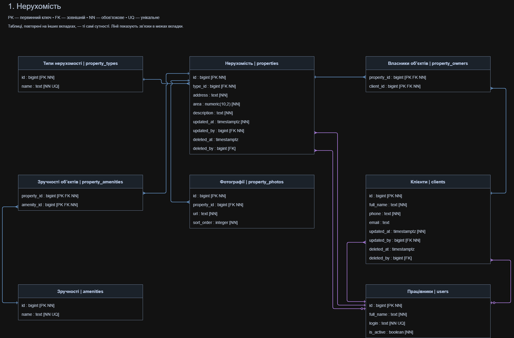
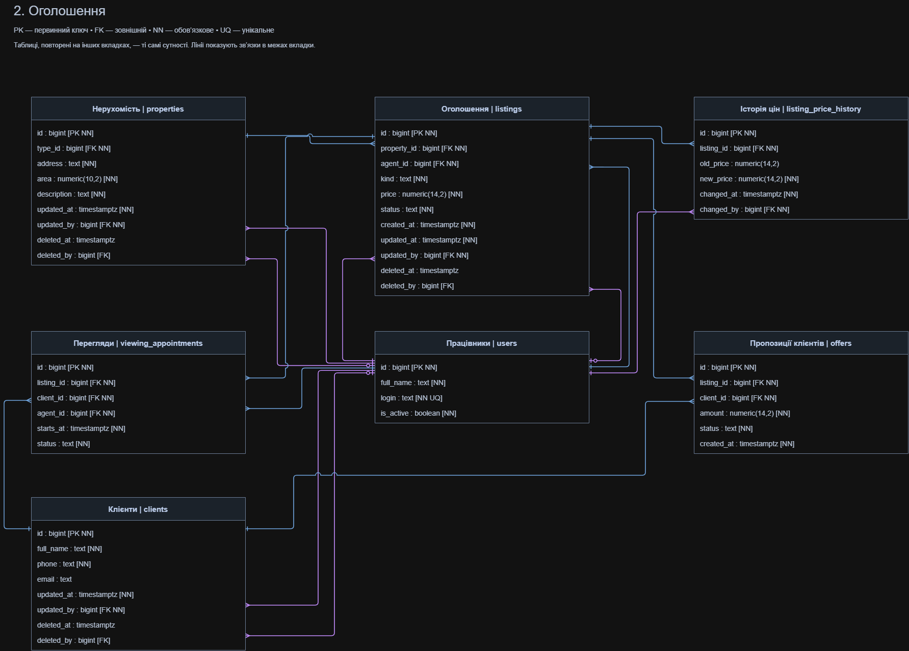
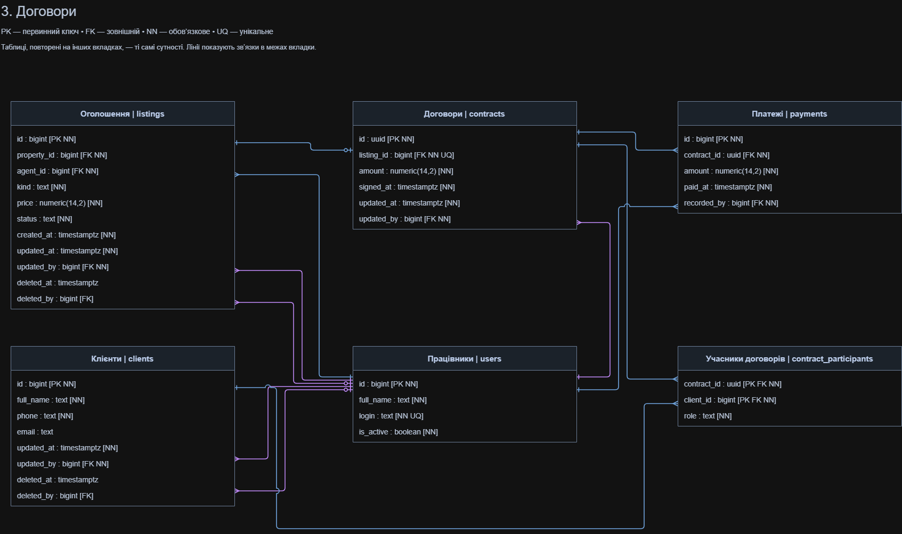
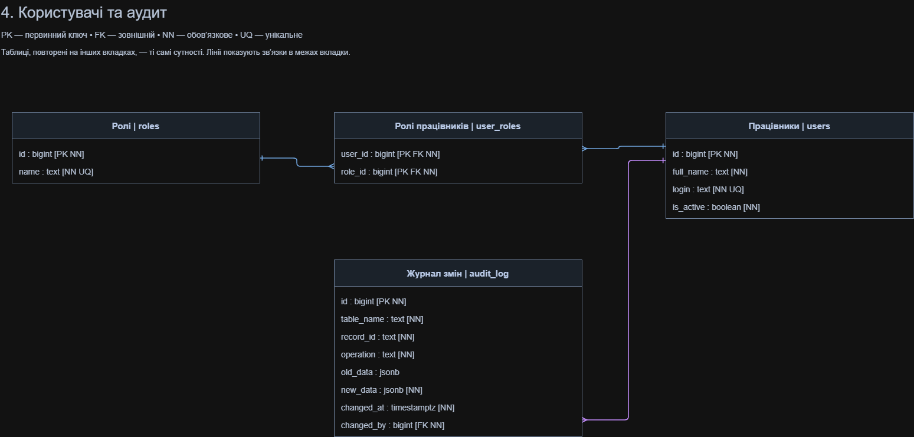

# Система управління нерухомістю

Навчальний проєкт на C# та PostgreSQL для агентства нерухомості. Консольний застосунок працює з клієнтами, об’єктами, оголошеннями, переглядами, пропозиціями, договорами та платежами.

Технології: C#, .NET 10, Npgsql, PostgreSQL. Доступ до даних організовано за патернами Repository + Unit of Work: читання через View, зміни через збережені процедури.

## Де що знаходиться

| Файл або папка | Призначення |
|---|---|
| [docs/Requirements.md](docs/Requirements.md) | Вимоги до системи, бізнес-правила та відповідність завданню |
| [docs](docs) | Чотири зображення ER-діаграми |
| [sql/01_schema.sql](sql/01_schema.sql) | Схема `estate`, таблиці, ключі, обмеження та індекси |
| [sql/02_logic.sql](sql/02_logic.sql) | Процедури, функції, тригери та View |
| [sql/03_seed.sql](sql/03_seed.sql) | Початкові демонстраційні дані |
| [sql/04_checks.sql](sql/04_checks.sql) | Перевірки обмежень і бізнес-правил |
| [Program.cs](Program.cs) | Консольне меню та завантаження налаштувань |
| [Data.cs](Data.cs) | Репозиторії, підключення до PostgreSQL та Unit of Work |
| [ContractService.cs](ContractService.cs) | Оформлення договору з учасниками й платежем в одній транзакції |
| [appsettings.example.json](appsettings.example.json) | Приклад налаштувань підключення |

## Запуск

Потрібні PostgreSQL, .NET 10 SDK та Visual Studio з підтримкою .NET 10 або .NET CLI. pgAdmin можна використовувати для створення БД і виконання SQL.

### 1. База даних

1. Створіть порожню базу даних `RealestateDb`.
2. Відкрийте Query Tool саме для цієї БД.
3. По черзі виконайте повний вміст файлів `01_schema.sql`, `02_logic.sql`, `03_seed.sql` з папки `sql`.
4. Виконайте `04_checks.sql` для перевірки реалізації.

Скрипти 01–03 призначені для початкового розгортання в порожній БД. Повторно виконувати їх при кожному запуску програми не потрібно.

### 2. Налаштування підключення

Скопіюйте `appsettings.example.json` у `appsettings.json` поруч із файлом `.csproj`. Вкажіть власні параметри PostgreSQL:

```json
{
  "ConnectionStrings": {
    "RealEstate": "Host=localhost;Port=5432;Database=RealestateDb;Username=postgres;Password=YOUR_PASSWORD"
  }
}
```

Назва БД має точно відповідати створеній. `appsettings.json` з локальним паролем виключений із Git через `.gitignore`.

Програма читає налаштування з папки зібраного застосунку. У властивостях `appsettings.json` у Visual Studio встановіть **Copy to Output Directory → Copy if newer**. Еквівалентне налаштування в `.csproj`, якщо його ще немає:

```xml
<ItemGroup>
  <None Update="appsettings.json">
    <CopyToOutputDirectory>PreserveNewest</CopyToOutputDirectory>
  </None>
</ItemGroup>
```

### 3. Застосунок

Відкрийте рішення `RealEstate.Console.slnx` або файл проєкту `.csproj` у Visual Studio, відновіть NuGet-пакети, зберіть і запустіть проєкт.

Альтернативно виконайте в папці з `.csproj`:

```sh
dotnet restore
dotnet run
```

## Відповідність завданню

| Вимога | Реалізація |
|---|---|
| Схема БД із полями, ключами та зв’язками | Чотири зображення нижче |
| Щонайменше 15 сутностей | 18 таблиць у `01_schema.sql` |
| Вимоги, soft delete, дата й автор зміни | `Requirements.md`; `deleted_at` і `deleted_by` у clients, properties, listings; `updated_at` і `updated_by` також у contracts |
| Реляційна СУБД | PostgreSQL |
| Щонайменше 10 програмних об’єктів БД | 18 процедур, 6 функцій, 10 тригерів і 16 View у `02_logic.sql` |
| Два типи індексів | B-tree та GIN у `01_schema.sql` |
| Repository + Unit of Work | `Data.cs` та `ContractService.cs`; читання через View, зміни через CALL |

## Можливості застосунку

- Створення та редагування клієнта, м’яке видалення, перегляд кошика й відновлення.
- Роботу з об’єктами та оголошеннями, зміну ціни й перегляд її історії.
- Оформлення договору: учасники, перший платіж і закриття оголошення зберігаються в одній транзакції.
- Відкат транзакції: демонстраційний сценарій навмисно додає від’ємний платіж, після помилки всі зміни цієї операції скасовуються.
- Перегляд журналу змін та результатів SQL-перевірок.

Для оформлення нового договору оберіть активне оголошення, за яким ще немає договору.

## ER-діаграма

Схема поділена на чотири тематичні зображення. Таблиці, повторені на різних зображеннях, позначають ті самі сутності БД.

### 1. Нерухомість



### 2. Оголошення



### 3. Договори



### 4. Користувачі та аудит




---

## Лабораторна робота 2 — NoSQL

У другій лабораторній роботі досліджено використання NoSQL-баз даних у системі управління нерухомістю та проведено порівняння продуктивності з PostgreSQL.

### Використані технології

- **PostgreSQL** — реляційна модель зберігання нерухомості у трьох пов'язаних таблицях.
- **MongoDB** — документна NoSQL-база для зберігання нерухомості разом із фотографіями та зручностями.
- **Redis** — NoSQL-база типу key-value для кешування та лічильників переглядів.
- **Python** — автоматизоване тестування продуктивності.

### Реалізація

Для порівняння згенеровано 100 000 об'єктів нерухомості:

- **PostgreSQL:** 1 200 000 записів у трьох таблицях.
- **MongoDB:** 100 000 документів із вкладеними фотографіями та зручностями.

Проведено 10 200 вимірювань у п'яти сценаріях:

1. Читання одного об'єкта.
2. Читання 50 об'єктів.
3. Фільтрація за типом і площею.
4. Оновлення опису.
5. Додавання нового об'єкта.

### Файли лабораторної

| Файл | Призначення |
|---|---|
| [postgres.sql](NoSQL/postgres.sql) | SQL-структура, генерація даних і запити |
| [mongodb.js](NoSQL/mongodb.js) | Генерація документів і запити MongoDB |
| [redis.txt](NoSQL/redis.txt) | Базові команди Redis |
| [benchmark.py](NoSQL/benchmark.py) | Автоматизоване порівняння швидкодії |
| [results.csv](NoSQL/results.csv) | Результати вимірювань |

### Результати

| Операція | PostgreSQL, мс | MongoDB, мс |
|---|---:|---:|
| Читання одного об'єкта | 0.207 | 0.215 |
| Читання 50 об'єктів | 0.894 | 0.386 |
| Фільтрація 50 об'єктів | 0.832 | 0.609 |
| Оновлення опису | 29.431 | 0.243 |
| Додавання об'єкта | 25.390 | 0.233 |

Наведено медіанні значення затримок. Результати запису залежать від налаштувань транзакцій і підтвердження збереження даних, тому не є універсальним показником переваги однієї СУБД.

Усі матеріали другої лабораторної розміщено в папці [NoSQL](NoSQL/).

